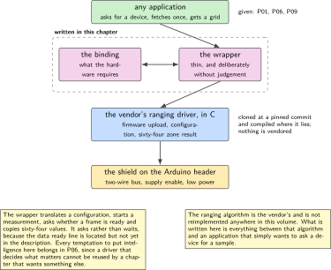
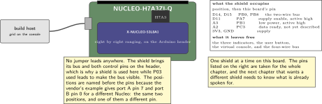
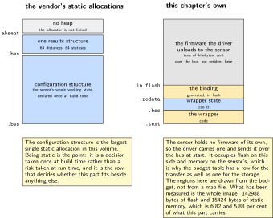
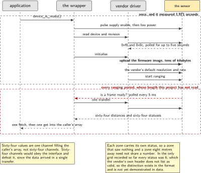
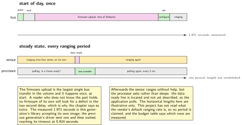

# P05. The zones: an out-of-tree driver

> **Target:** NUCLEO-H7A3ZI-Q with the eight by eight ranging shield, two-wire bus first  
> **Theme:** A kernel driver with its own binding, and a vendor library cloned at a pin

> [!NOTE]
> **Where this sits in the product spine**
>
> This chapter serves the first behaviour, **presence with a hold and a release**, by replacing the generated range source P01 ran on with a real one. P01 keeps the state machine; this chapter supplies its input. It also sets up the second behaviour, since the sixty-four numbers produced here are what P06 has to decide about.

> **Key facts**
>
> - **Board:** NUCLEO-H7A3ZI-Q with the X-NUCLEO-53L8A1, the only shield fitted
> - **Peripherals:** The two-wire bus, enabled by the overlay of P03; two control pins the shield needs and the tree's own driver has no property for; one data-ready line, located and not yet described
> - **Toolchain:** As the front matter, plus the vendor's library cloned at a pinned commit and compiled where it lies, and the sensor's firmware image fetched as a binary blob
> - **Operating system:** One application thread that polls for a frame, because the data-ready line is not in the description yet, and the chapter says so rather than claiming a trigger it does not have
> - **Difficulty:** 5 of 5
> - **Effort:** 5 evenings of about four hours
> - **Deliverable:** A binding and a driver that let the sixty-four zone sensor be used through the same interface as a three-axis accelerometer, with the vendor's code cloned at a pinned revision rather than copied into the repository

## Why this project

Everything in this volume that knows whether a room is in use eventually rests on a sensor that can tell a person from a chair. The part on this bench that can do that resolves an eight by eight grid of distances, and the question it answers is not how far away something is but how much of the room is occupied and roughly where. That is a different question from the one a single-point rangefinder answers, and the difference is why this part was chosen over anything cheaper.

The chapter exists because that part has no driver in the tree. What the tree does carry is a complete driver for the generation immediately before it, and that turned out to be the most useful fact in the project: it gives a working comparison rather than a blank page. The vendor publishes a full ranging implementation in C, written against no particular operating system, and the work here is to make it a first-class device: a binding that describes the hardware, a wrapper that maps the vendor's interface onto the sensor interface every other chapter uses, and a build arrangement that brings the vendor's source in at a pinned revision without copying it into the repository.

The harder half of the chapter is not code. It is the argument about what the device is allowed to perceive, and it belongs here because this is the chapter where perception is chosen rather than inherited.

> [!NOTE]
> **What this chapter does not claim**
>
> This part is a time-of-flight array. It measures distance by timing light, resolves sixty-four zones, and produces nothing from which a person could be identified. It is not radar, and the volume never calls it that. The published literature on sensing people without cameras is largely about millimetre-wave radar, and that literature is cited below for its framing and not for its method, because the method does not transfer.
>
> The vendor library is used unmodified, and this repository contains no copy of it. It is cloned at a commit written into the build file, so the revision is a fact rather than a memory and the licence stays with the code it covers.
>
> **What this chapter has seen on a bench, and what it has not.** The part answered at its address, identified itself as a different member of the family from the one the tree's driver expects, accepted its own generation's firmware image in 1.971 seconds where the previous generation's driver reached a timeout at 5.924, and returned one coherent grid of sixty-four distances. From a power cycle on Saturday 17 October 2026 at 15:44 until the morning of Tuesday 20 October 2026 it answered at no address, and then it answered again, on seven boots, after the bench had been photographed and handled to photograph it. What brought it back is not known and the record says so: the handling may have reseated the shield, or not, and the photographs do rule out the one hypothesis the record had named, a ground lead in a socket under the shield. Every number quoted below is from a dated run. The chapter's criteria table says which criteria are still open.

## Why not a microphone, and why not a camera

The two cheaper ways to tell whether a room is in use are a microphone and a camera, and both are worse products rather than merely worse engineering.

A microphone with an energy threshold works. It is cheap, it needs no line of sight, and a room with somebody in it is reliably louder than a room without. It is also a device that could, with a firmware change nobody outside the company would see, record what is said in a room designed for private conversations. The threshold is not the problem; the capability is. A device whose hardware cannot do the thing people fear is a device that does not have to be trusted about it, and that is worth more than the component cost difference.

A camera is the same argument with a sharper edge, plus two engineering ones. It fails in the dark and it fails when somebody tapes over it, and both failures look like an empty room. The survey literature on sensing people without cameras opens with exactly this point, that cameras fail on privacy and on lighting, and that framing is worth borrowing even though its subject is a different sensor. The time-of-flight array shares the useful half: it works in the dark, it yields nothing identifiable, and what it loses is the ability to tell a person from a coat on a chair, which is a cost this volume names rather than hides.

## Prior art and what to reuse

| Source | What it gives | What it does not | Licence |
| --- | --- | --- | --- |
| The vendor's ultra lite driver for this part, in C | The whole ranging implementation: firmware upload to the sensor, configuration, and a sixty-four zone result structure | Any integration with this operating system. There is no binding, no device model and no trigger support, and that gap is the chapter | Vendor, permissive with attribution; the text stays with the clone |
| The in-tree driver for the previous generation of the same part | More than a convention to copy: a complete driver that binds this part, uploads an image to it and times out, which is a working comparison and the chapter's central demonstration | Any pin. Its binding is eleven lines and declares no GPIO property, so it cannot power the shield, and it never checks what it is talking to | Apache-2.0 |
| The sensor interface documentation | The channel and trigger vocabulary, and the rule that one fetch serves every channel | A channel for a grid. Choosing how sixty-four values are presented is a design decision this chapter makes and defends | Apache-2.0 |
| The vendor's own example for this shield | The two control pins by name, their order and their two millisecond waits, and the connector positions once resolved through the board they used | A mapping to this board. Their ports are their Nucleo's, and one of the two positions is a different pin here | Vendor |
| The board's Arduino connector description, for both boards | The map from a connector position to a port and a pin, which is what makes the vendor's ports usable without copying them | Anything about the shield | Apache-2.0 |
| P03, in this volume | The overlay that enables the bus at all, since the board enables neither | Anything about this part | Apache-2.0 |
| The anchor: the kernel's own latency suite, and the published interrupt figures | The in-tree `latency_measure` suite, already built on this board for P04, measures an interrupt reaching the thread it wakes; and the independent laboratory's benchmark of Thursday 22 September 2022 reports an interrupt reaching its handler in 101 cycles under FreeRTOS against 143 under Zephyr, on a Cortex-M4 at 168 MHz | A sensor. The suite raises its interrupt in software; this chapter's arrives on a pin from the part, and the GPIO path between the two is what this chapter adds and has to account for before the figures can be compared | Apache-2.0; the published figures as published |
| Survey literature on sensing people without cameras | The framing: cameras fail on privacy and on lighting, and a sensor that yields nothing identifiable is a different product rather than a cheaper one | A method. That literature is about millimetre-wave radar; this part times light. One sentence of difference is mandatory or the citation is false | Published |

*Table 5.1. Prior art for P05. The ranging algorithm is entirely the vendor's and is not reimplemented. What is written here is everything between that algorithm and an application that wants to ask a device for a sample. The second row changed during the work: it was expected to supply conventions and it supplied a falsifiable comparison instead.*

## Parts from the inventory

| Part | Role | Interface |
| --- | --- | --- |
| NUCLEO-H7A3ZI-Q | The host. One shield is fitted and it is this one | Micro USB to the build host |
| X-NUCLEO-53L8A1 | The eight by eight ranging shield, the only part on this bench that resolves zones | Arduino header, two-wire bus |
| Build host | Builds and flashes, and reads the grid from the virtual console | As the front matter |

*Table 5.2. Inventory for P05. The accelerometer shields stay in the drawer: one shield at a time is an address and supply constraint on this board, not a preference, and a chapter that fitted two would be describing a bench that does not exist.*

## System architecture



*Figure 5.1. Four layers, of which this chapter writes two. The vendor's driver and the application are both given; the binding and the wrapper in between are the work. The vendor's library is cloned at a pinned commit and compiled where it lies, so no copy of it enters this repository and the revision is part of the build rather than part of the history.*

The arrangement is worth one observation. The wrapper is the only place in the volume where a vendor's own interface meets the operating system's, and it is deliberately thin: it translates a configuration, starts a measurement, asks whether a frame is ready, and copies sixty-four values. Every temptation to put intelligence there belongs in P06 instead, because a driver that decides what matters is a driver that cannot be reused by a chapter that wants something else.

## Configuration

Three descriptions are built, not one, and the third is a control. The first points the part at the driver the tree already carries for the generation before it, which is how the comparison is made. The second points it at this project's own driver and binding. The third is the second with the two pin properties removed and nothing else changed, which is how a claim about those pins can be refuted.

```dts
/* overlays/own_driver.overlay. The bus is enabled by the pattern P03
 * established; the board's own description enables neither bus.
 *
 * THE PINS ARE NAMED BY CONNECTOR POSITION AND NOT BY PORT. The vendor's
 * example gives port A pin 7 and port B pin 0 for the Nucleo they tested.
 * Those are positions D11 and A3 on that board. This board puts A3 on port B
 * pin 1, so a port copied across would have been right once and wrong once.
 */
&i2c1 {
    status = "okay";
    pinctrl-0 = <&i2c1_scl_pb8 &i2c1_sda_pb9>;
    pinctrl-names = "default";
    clock-frequency = <I2C_BITRATE_FAST>;

    zones: vl53l8cx@29 {
        compatible = "st,vl53l8cx";
        reg = <0x29>;
        pwren-gpios = <&arduino_header ARDUINO_HEADER_R3_D11 GPIO_ACTIVE_HIGH>;
        lpn-gpios   = <&arduino_header ARDUINO_HEADER_R3_A3  GPIO_ACTIVE_HIGH>;
        status = "okay";
    };
};

/ { aliases { zones = &zones; }; };
```

```yaml
# dts/bindings/sensor/st,vl53l8cx.yaml, the part this chapter actually writes
description: Eight by eight multizone time of flight ranging sensor
compatible: "st,vl53l8cx"
include: [sensor-device.yaml, i2c-device.yaml]
properties:
  pwren-gpios:
    type: phandle-array
    description: |
      Supply enable. The part is held unpowered until this is driven high.
      Absent means a driver drives nothing and the shield must be powered by
      something outside this description.
  lpn-gpios:
    type: phandle-array
    description: |
      Low power. Absent means a driver drives nothing.
  int-gpios:
    type: phandle-array
    description: |
      Data ready. Absent means a driver polls instead.
```

**All three are optional, and the first draft of this chapter argued the opposite.** It said a line the hardware needs should be marked required, so that a description which cannot work is refused at build time rather than on a bench. That reasoning is sound and it was wrong here, for a reason the bench supplied: the claim that those two pins are what bring the part to life was drawn from a pair of runs between which two things had changed. A property that cannot be left out cannot be the subject of a control, and the control is `own_driver_nopins.overlay`, which is this file's one variable removed and nothing else touched. A binding encodes what the hardware demands, and this project had to be able to find out what that was.

Two further decisions are recorded here because their absence is deliberate. There is no resolution property and no ranging frequency property, because this project has not read what the vendor's defaults are and a key whose value is a guess is worse than no key. And there is no reset property, because this shield has no reset line: it has a supply enable and a low power line, which is not the same thing and was the first draft's clearest factual error.

## Wiring



*Figure 5.2. Nothing is wired by hand. The shield sits on the Arduino header and brings its own bus and both control pins, which is exactly why a shield is used here while P03 used jumper leads. The figure gives the connector position before this board's pin for every signal, because the position is the part that transfers to another board and the pin is not.*

## Memory and timing budget



*Figure 5.3. Where sixty-four zones live. The vendor's own working buffer is the largest single allocation in any chapter of this volume, and it is static, declared once, and never resized. The regions are drawn from the budget rather than from a map file, and the note gives the two figures that have actually been measured.*

| Quantity | Budget | Measured | Margin |
| --- | --- | --- | --- |
| Whole image, flash | under 256 kB | 142988 B | 6.82 per cent of 2 MB |
| Whole image, static memory | under 64 kB | 15424 B | 5.88 per cent of 256 kB |
| Vendor configuration structure | under 16 kB static | not measured alone | not measured |
| One results structure, 64 zones | under 2 kB static | not measured alone | not measured |
| Dynamic allocation | zero bytes | zero by construction | not applicable |
| Sensor firmware upload, at start | under 90 kB over the bus | not measured | not measured |
| Initialisation, image upload included | under 2 s | 1.971 to 1.981 s, nine runs | 19 ms |
| Ranging period, vendor default at eight by eight | not budgeted | 976 to 982 ms, about 1 Hz | not applicable |
| First frame after start | not budgeted | 2453 ms since boot, seven boots | not applicable |
| The same, through the tree's driver for the generation before | would not complete | 5.924 s to timeout | not applicable |
| One transfer, 64 zones | under 20 ms at 400 kHz | not measured | not measured |
| Trigger to sample available | under 25 ms | not posable yet | no trigger wired; the application polls every 5 ms and sees a frame 528 to 882 ms after the previous one |

*Table 5.3. The budget for P05. The two image rows are from a build, the two timing rows from dated runs, and every other row says it is not measured rather than carrying a plausible number. The last row is not merely unmeasured: there is no trigger connected, so the quantity does not yet exist to measure.*

## Software design (UML)



*Figure 5.4. Start of day, then the steady state. The firmware upload at start is the unusual part: this sensor holds no firmware of its own, so the driver sends it one over the bus before anything works, and a chapter that did not say so would leave a reader puzzled by a two second delay.*

Three design decisions are worth defending in writing.

The sixty-four zones are presented as one channel read with a buffer rather than as sixty-four channels. Sixty-four channels would fit the interface's letter and defeat its purpose, since the application would make sixty-four calls for data that arrived in one transfer. A single channel that fills a caller's array keeps the one fetch, many gets discipline that P03 established.

The driver reports a zone's status alongside its distance rather than folding an invalid reading into a large number. A zone that saw nothing and a zone that is eight metres away are different facts, and a driver that returns a number for both forces every consumer to guess. **That is the format, and the data exercises it from the second frame on.** When this chapter was last rewritten the only grid recorded carried status 6 in all sixty-four zones, and so did the noise grid before it, while the vendor's header names 5 and 9 as the values meaning ranging OK; the chapter refused to choose between two readings of that. Seven boots on Tuesday 20 October 2026 chose, three of them after the prediction was written: 6 is the first frame after ranging starts, every time, and 5 is every frame after it. A first frame can be a coherent surface or sixty-four zones of noise and the status does not say which, so the vendor is right to exclude it. The same day, zones that saw no target reported 255 with a target count of zero and a number still printed in the distance, which is the second criterion observed rather than argued; and with an object at the sensor face every zone reported 4 and the reduction gave the presence machine nothing eight frames out of eight, rather than a range of zero.

The application polls for a frame rather than waiting on a line, and the chapter says so plainly because the alternative is to claim a trigger the description does not carry. The data-ready line's connector position is now established, which is the step that was missing, and the property for it is written into the binding. It is not in the overlay because an unexplained regression is open and the description is the thing under test.



*Figure 5.5. Start of day against the steady state. The firmware upload dominates the first two seconds and happens once; after that the sensor ranges on its own while the processor asks it whether a frame is ready. The horizontal lengths in the lower half are illustrative: this project has not read the vendor's default ranging rate, so no period is claimed.*

## Data flow (ASCII)

```text
  start of day, once, measured at 1.971 s
  +-----------------------------------------------------------------------+
  | pulse supply enable low then high, then low power, 2 ms each          |
  | read device and revision, polling for up to 5 s, and refuse a part    |
  |   that answers as the generation before this one                      |
  | upload the firmware image over the bus, then start ranging            |
  +-----------------------------------------------------------------------+
                                   |
  steady state, period not established
                                   v
  +----------------+               +---------------------+   one fetch
  | the sensor     |               | the application     | ----------------+
  | ranges 64 zones|               | asks every 5 ms:    |                 |
  |                |               | is a frame ready?   |                 |
  +----------------+               +---------------------+                 |
         ^                                                                 v
         |  no line is connected yet, so nothing interrupts anything
  +--------------------------------------------------------------------------+
  | 64 distances, each with its own status, printed as a number because what  |
  | the values mean is documented only in a compiled help file in the pinned  |
  | tree. The two the vendor's header calls valid are marked and counted, and |
  | the only grid recorded here carried neither of them in any zone           |
  +--------------------------------------------------------------------------+
                                   |
                                   v
                 P01 asks: how many zones are occupied, and P06 asks: which
                 of these sixty-four numbers is worth sending anywhere
```

## Repository layout

```text
projects/05-the-zones/
  CMakeLists.txt                  # clones nothing; names the pinned commit
  prj.conf
  overlays/existing_driver.overlay    # the tree's driver for the generation before
  overlays/own_driver.overlay         # this project's driver and binding
  overlays/own_driver_nopins.overlay  # the control: the two pins removed
  dts/bindings/sensor/st,vl53l8cx.yaml
  src/vl53l8cx.c                  # the driver: this chapter's work
  src/vl53l8cx_platform.c         # the six functions the vendor library calls
  src/platform.h                  # and the struct it calls them through
  src/zones.h                     # sixty-four distances, statuses and targets
  src/zone_status.h               # the one definition of which statuses mean a reading
  src/reduce_nearest_valid.c      # sixty-four numbers to one, by a policy in its own name
  src/reduce_nearest_valid.h
  src/main.c                      # the bus scan, and the grid
  src/shield_power.c              # only for the first description
  src/identify.c                  # only for the first description
  src/build_stamp.h               # what the image is, generated at every link
  host/test_reduce_nearest_valid.c    # nine cases, and the refusals are the point
  host/Makefile                       # make check, and make mutants to break it on purpose
  docs/DESIGN.md                  # written before any code, with its predictions
  docs/BENCH.md                   # every run, dated, each with its prediction
  docs/REDUCTION.md               # the policy's own page, which DESIGN.md asked for
  README.md
```

There is no `west.yml` and no module directory, and the first draft of this chapter had both. The vendor's library is brought in by the build file, which names the commit; a module would have been the tidier arrangement and it was not the one that worked here.

## Steps

**Step 1.** **Ask the tree what it already has, before writing anything.** This is a step because the answer decides the chapter. It returned something better than nothing and worse than a driver: no support for this part, and a complete driver for the generation immediately before it.

```bash
find zephyr/drivers/sensor -ipath "*vl53*"
grep -rln "vl53l8" zephyr/dts/bindings/sensor/ || echo "nothing for this part"
```

**Step 2.** **Point the part at that driver and see what happens.** One build, and it replaces a page of speculation. It bound the node, uploaded tens of kilobytes to the part and reached its timeout at 5.924 seconds, which is a far more specific fact than a page about what might be different between two generations.

**Step 3.** **Clone the vendor's library at a commit and write the commit down.** Nothing is copied into the repository. The build file names the revision and fails with the clone command in the message when it is absent, because a missing clone otherwise arrives as a compiler failing to find a header.

```bash
git clone https://github.com/STMicroelectronics/x-cube-tof1.git ~/src/x-cube-tof1
git -C ~/src/x-cube-tof1 checkout c12709c3ac802d91dd2a215178f53cb94c024709
west blobs fetch hal_st     # the sensor's firmware image, which is not in the tree
```

**Step 4.** **Write the binding before the driver.** It is the specification of what the hardware needs, and writing it first prevents a driver that quietly assumes a line nobody described. Mark the lines optional and say in each description what a driver does when one is absent, so that the description can be varied deliberately.

**Step 5.** **Write the porting layer, which is six functions and one struct.** The vendor's library calls out through a platform header: two byte accessors, two block accessors, a buffer swap and a delay. The block writes go out as two bus messages rather than one copied buffer, so a sixty-four zone frame is not duplicated in memory to be sent.

**Step 6.** **Drive the two control pins in the vendor's own order, and have the helper say what it did.** The order and the two millisecond waits come from their example rather than from reasoning. The reporting is not decoration: a helper that returns success silently both when it pulses a line and when the description carries no line makes those two cases indistinguishable in every log, and four runs were reasoned about before anything on a console had ever said a pin was driven.

```c
static int pulse_line(const struct gpio_dt_spec *line, const char *what)
{
    int rc;

    if (line->port == NULL) { return 0; }      /* described as absent */
    rc = gpio_pin_configure_dt(line, GPIO_OUTPUT_INACTIVE);
    if (rc != 0) { return rc; }
    k_msleep(PULSE_MS);
    rc = gpio_pin_set_dt(line, 1);
    if (rc != 0) { return rc; }
    k_msleep(PULSE_MS);

    LOG_INF("%s pulsed low then high on %s pin %d, %d ms each", what,
            line->port->name, line->pin, PULSE_MS);
    return 0;
}
```

**Step 7.** **Identify the part, and refuse the one this driver is not for.** The vendor's own check is four bus transactions. This driver polls it, because a part that has just been powered may not answer at once, and refuses both a wrong family byte and the revision the previous generation answers with. The function is `vl53l8cx_dev_init` rather than the obvious name, because the obvious name is the vendor library's and the local one shadowed it.

**Step 8.** **Decide how sixty-four values are presented, and write down why.** One structure filling the caller's array, with the status and the target count beside the distance. Sixty-four channels would be obedient to the interface and useless.

```c
struct zones_grid {
    int16_t distance_mm[64];
    uint8_t status[64];        /* the vendor's value, not a word */
    uint8_t targets[64];       /* zero means the zone saw nothing at all */
    int8_t  silicon_temp_degc;
};
```

**Step 9.** **Take several frames in one run, not one.** A processor reset does not reset this part, so a single frame after a reset is a frame from a part that is mid-flight. One button press produced two boots whose grids were a surface and sixty-four values of noise, and printing four frames with the time each waited makes the settling visible instead of leaving it to be inferred from two logs.

**Step 10.** **Look at the grid as a grid.** Print it as eight rows of eight on the console. A sensor whose output has never been looked at spatially is a sensor whose orientation nobody knows, and orientation is the first thing P01's thresholds depend on.

```bash
source ~/zephyrproject/.venv/bin/activate   # or a fresh configure finds no modules
cmake -B build-p05-own -GNinja -DBOARD=nucleo_h7a3zi_q \
      -DDTC_OVERLAY_FILE=overlays/own_driver.overlay -S projects/05-the-zones
ninja -C build-p05-own
```

**Step 11.** **Connect the data-ready line and remove the polling.** Not done, and the chapter says why rather than quietly omitting it. The position is settled: the vendor's example gives port A pin 4 on their board, which is connector position A2, which is port C pin 3 here. It is not in the overlay because a regression is open and the description is the thing under test.

**Step 12.** **Swap it into P01 and confirm the state machine does not change.** The generated source goes, the real one arrives, and not one line of the presence machine moves. If it does, P01 was wrong about where the boundary was. This needs a host and no hardware, and it has not been done.

## Build, flash and debug

Two things make a first build fail in ways that name the wrong cause. A fresh configure without the workspace's virtual environment activated finds no modules, so the vendor devicetree directory is off the include path and the board's own description fails to preprocess on an include that is present the whole time. And a run without the sensor's firmware image fetched fails at initialisation with the library's generic error, which reads exactly like a wiring fault. Both are one line each and both cost an evening when missed. When re-testing either, remove the build directory in the same command: a configure that reuses a failed build directory reads a cache, and on this project that turned a correct diagnosis into a withdrawn one.

Read the build stamp before reading anything else, and note what it is. It is generated at every build, with the time in full and the commit, because the obvious version of it was a compile-time macro in the application file: an edit to the driver does not recompile that file, so a genuinely new image printed a stamp more than an hour old and the result was nearly discarded as a stale flash.

Beyond that, the chapter's debugging is dominated by one failure: the part does not answer. The bus scan exists to turn that into three different answers, and the order of reading it is the order of its own output rather than a list of suspects. If nothing answers anywhere, the part is not electrically on the bus and no address, no bus speed and no register sequence will change that; check power, the two control pins, how the shield is seated, and the interface selection. If something answers at the address the overlay names, the description is right and the failure is inside initialisation, which points at the firmware image or at a real difference between generations. If something answers elsewhere, the scan has printed the right address. And if nearly everything answers, the scan is void on this controller and nothing it printed is evidence, which it says itself rather than reporting a hundred and twelve sensors.

The console prints the grid as eight rows of eight with the status beside each value. That is more console traffic than the rest of the volume combined and it is deliberate for this chapter only: a grid that is not looked at is a grid nobody can reason about, and later chapters consume reduced numbers rather than the grid itself.

## Verification and acceptance criteria

- **The device comes up, and failure is reported as failure. Met.** With the part not answering, the application printed that the device was not ready, printed the scan that diagnoses it, and printed no grid. *Refuted if* it reported zeroes or an empty grid, which would make an absent sensor look like an empty room.
- **Nothing and far are different facts. Observed.** On Tuesday 20 October 2026, with a hand partly in the field, the zones that saw no target reported status 255 and a target count of zero, and in no other zone did either appear; the distance beside them was a number near thirty millimetres and not a measurement. A surface at 2.58 metres reported status 5 in every zone. Only the status and the count tell the two apart, which is what the criterion asked. *Refuted if* an empty zone and a measured zone ever share a status the vendor calls valid.
- **One fetch serves sixty-four zones. By construction, not yet counted.** The application makes one fetch and one read per frame. The count of bus transactions underneath is several, by the vendor library's construction, so the criterion is about the interface rather than the wire. *Refuted if* the application's call count scales with the number of zones read.
- **The application never polls. Not met, deliberately.** It polls every five milliseconds. The line's position is established and the binding declares the property; the overlay does not carry it yet. *Refuted if* a thread's run count follows a loop rate once the line is connected.
- **The grid is the right way up. Open, after an hour that produced nothing a reader can use.** Three hand-held protocols on Tuesday 20 October 2026, a hand, a finger and two pens, each put the object somewhere other than where the instruction said, because the instructions referenced board features off the sensor's axis and named distances a hand cannot hold. The bench log carries all nine runs and the two faults. The orientation is not read from a document after all: at the pinned commit the vendor's interface carries no statement of its zone ordering, and the vendor's own manual did not answer from this bench, which its notes already say of that server. So it is measured rather than predicted. [docs/ORIENTATION.md](../projects/05-the-zones/docs/ORIENTATION.md) writes two runs that measure it: the board standing so that gravity supplies the second reference, a rigid card in a clamp rather than a hand, and its straight edge through the lens window's own axis, covering half the field in one run and the other half in the other. Eight maps are possible, four rotations each with or without the mirror a lens implies, and the two runs select one. *Refuted if* either run splits the printed grid into anything but four whole rows or four whole columns, which says the edge missed the axis or the card was not flat to it; or if both runs split the same axis, which says the two cards were not perpendicular and neither run is read; or if the map selected contradicts both readings already in the record, the single lit zone 56 and the pens' corner at printed bottom left, which would earn a third run before anything is written here.
- **P01 is unchanged. Half met, and the half that is met is the half that had to be written.** The criterion narrows to two claims, and [docs/DESIGN.md](../projects/05-the-zones/docs/DESIGN.md) said so before any code: P01's application is unchanged, and the thing that chooses one number from sixty-four is new and is not P01's. That second thing now exists as `src/reduce_nearest_valid.c`, with its policy in its filename, its cost written down, no threshold of its own, and a host suite that needs no board. What remains is the byte comparison of P01's own object across the two range sources, which needs a build and no hardware. *Refuted if* a single line of the presence machine had to move, or if the reduction turns out to live inside the driver after all.
- **The revision travels with the code. Met, in a different form than first written, and now by a check rather than by inspection.** Nothing is vendored, so there is no committed licence file to check. Three things are checked instead, by `scripts/check_vendoring.py` in continuous integration: that no C or C++ source under the projects directory fails to name its own path, which is how a file copied in from elsewhere announces itself; that an external source's path never defaults inside this repository; and that its revision is declared as a value the build reads rather than as a comment. **The third was added because it was false.** The pin lived only in a comment, so the build compiled whatever revision the clone happened to be at while this chapter and that build file both claimed the version was part of the build. The build now asks the clone what revision it is at and refuses to configure against any other, with an explicit option for doing so on purpose. *Refuted if* any of the three fails, and all four of the checker's failure cases were built deliberately and watched being detected before it was trusted.
- **The replicated claim: the kernel's own interrupt-to-thread figure, on this board, from a real line. Not yet posable, and the order of work is written.** The data-ready line's position is known and the overlay does not carry it, which is the fourth criterion. Once it does, two figures are taken: from the line's edge to the first instruction of the fetching thread, by the cycle counter P04 justified, and the processor time of that path against today's five millisecond poll, from the kernel's thread runtime statistics. The suite's own interrupt rows are run on this board first, so that the comparison is between two figures from one board and not between this board and a publication. *Refuted if* the interrupt path costs more processor time than the poll, or if its edge-to-thread figure exceeds the suite's by more than the GPIO path accounts for, with that path's cost read from the reference manual and written here before the run.

## Variants

| Axis | This chapter | The alternative | Cost | Built in full |
| --- | --- | --- | --- | --- |
| Vendor source | Cloned at a pinned commit, compiled where it lies | A module in the manifest, or a copy in the tree | The module is tidier and was not what worked; the copy loses the revision and the licence | Here |
| Driver | This project's own, with a binding that declares the pins | The tree's driver for the generation before | It binds, uploads an image and times out at 5.924 s | Both |
| The two control pins | Declared in the node and driven by the driver | Declared in the user node and driven by an application | The second is fifteen lines and does not belong in a description of hardware | Both |
| Bus | Two-wire | Four-wire, faster for sixty-four zones | The shield's selection may need a soldered link, and there is none on this bench | Described, not run |
| Frame handoff | Polling | The data-ready line | One overlay property, held while a regression is open | Polling only |
| Presentation | One structure filling an array | Sixty-four channels | Obedient to the interface, useless in practice | Here |
| Where the reduction happens | Not here | In the driver | A driver that decides what matters cannot be reused | P06 |
| Sensing method | Timing light | Sound, or an image | A device that can record a private room, or one that fails in the dark | Here, as an argument rather than a build |

*Table 5.4. Variants touching P05. The last row is in the table deliberately: the choice of what the device is able to perceive is an engineering decision with the same standing as the choice of bus, and it is made once, here. Three of these rows were built both ways, which is unusual in this volume and is what made the chapter's central claim checkable.*

## Pitfalls

- **Expecting the part to work without a firmware upload.** It holds none. The two second start is not a defect and a reader who does not know that will look for one.
- **A build stamp that is a compile-time macro in one file.** It records when that file was last compiled, not when the image was linked, so an edit anywhere else leaves it stale. The failure direction is the bad one: it reports a new image as old, and the result gets thrown away.
- **A helper that returns success silently in two different cases.** One that pulses a line and one that finds no line described are indistinguishable in every log, and the second looks like the first for as long as nobody checks.
- **Copying a vendor's port and pin into a description.** They are their board's. Resolve them to a connector position through that board's own map, and check the map against something already known before trusting its answer.
- **Taking a vendor comment about valid values as a complete enumeration.** The header here names two values as ranging OK and the only grid this project recorded carried a third in every zone. The comment is not wrong; it is partial, and a marking built on it reads zero valid zones on a real surface.
- **Re-testing a configure in the same build directory.** It reads a cache, so it is not a test. The removal belongs in the same command as the thing being tested.
- **Folding an invalid zone into a large distance.** Every consumer then has to guess, and one of them will guess wrong in a way that reports an empty room as occupied.
- **Fitting a second shield.** One at a time on this board. The address and supply constraints are real and the failure is intermittent rather than clean.
- **Trusting the orientation.** Nothing in the datasheet tells a reader which corner of the printed grid is which corner of the room. And do not establish it with a hand: nine runs on one morning placed a hand, a finger and two pens everywhere except where the instruction said, because the instructions pointed at buttons and cables the sensor was not looking at and named distances a hand cannot hold. Anchor the object at the sensor, on a stand, at a measured height.
- **Reading the first frame.** It is status 6 on every boot and can be a surface or noise with nothing to tell them apart. The vendor excludes it and so must every consumer.
- **Letting the driver decide what matters.** It is the one change that would make this chapter unusable by the next one.

## Best practices applied

The third-party code is brought in by reference at a pinned revision and no copy of it enters the tree. The binding is written before the driver, and its properties are optional with each description saying what a driver does when one is absent, so that the description itself can be the subject of a control. Absence is reported as absence rather than as a default value. The driver distinguishes facts it can distinguish and refuses to collapse them, and where the data does not yet support the distinction the chapter says so instead of claiming the criterion. The presentation of the data is chosen for the consumer rather than for the interface's letter. Every figure quoted comes from a dated run and the ones that do not exist are marked not measured. And the choice of sensing method is argued in writing, once, so that it is a decision on record rather than an assumption repeated.

## Stretch goals

Connect the data-ready line at connector position A2 and replace the polling, which turns the fourth criterion from a statement into a measurement and is the one piece of work the tree has no precedent for in this family. Measure the bus time for sixty-four zones at both bus speeds and decide from the numbers whether the four-wire variant is worth the strapping question. Establish what the status values mean from a source that enumerates them, since the pinned tree documents them only in compiled help. Build the console grid into the chapter's evidence as a short recording of somebody walking across the sensor's field, which is the single most convincing artefact this volume can produce and costs an afternoon.

## Roadmap and next steps

P06 is the direct consumer and the reason the driver stays free of judgement: it decides which of these sixty-four numbers deserves to leave the device, and it needs the status array to do it honestly, which this chapter has shown is not yet something the data supports. P01 gains a real input here and its thresholds stop being arguable. P09 publishes what the two of them conclude, and P14 takes the same application to a second board, where this driver is the part most likely to need attention because it is the only one in the volume that is not upstream. The connector positions written into the overlay rather than ports are what make that last move cheap.

The refactor of Tuesday 20 October 2026 adds one run to this chapter's list and changes nothing measured: the data-ready line into the overlay, the suite's interrupt rows on this board, and then the edge-to-thread figure from the real line against them. That is the fourth criterion and the replicated claim in one run, and the chapter's first number that a reader can compare with a publication rather than with this bench alone.

## Portfolio evidence

The idiom this chapter proves is **maintainability**: the hardware is described in a binding, the vendor's code is brought in at a pinned revision without being copied, and the wrapper between them is thin enough to read in one sitting. What makes it unusually strong evidence is that the same application was built against two drivers and three descriptions, so the claim is a comparison rather than an assertion. The commands that prove it are

```bash
source ~/zephyrproject/.venv/bin/activate
cmake -B build-p05-existing -GNinja -DBOARD=nucleo_h7a3zi_q \
      -DDTC_OVERLAY_FILE=overlays/existing_driver.overlay -S projects/05-the-zones
cmake -B build-p05-own -GNinja -DBOARD=nucleo_h7a3zi_q \
      -DDTC_OVERLAY_FILE=overlays/own_driver.overlay -S projects/05-the-zones
ninja -C build-p05-existing && ninja -C build-p05-own
```

which build one application against the tree's driver for the previous generation and against this project's own, from the same source with a different description. The single command that produces the evidence once both are configured is `ninja -C build-p05-own`, and the one that produces the comparison it is read against is the same line with the other build directory. Publish the binding, the driver's initialisation path, the two consoles side by side, the one recorded grid with its row and column means, and the bench log, which carries every run with the prediction it was made against including the ones that were wrong.

## Sources

- The vendor's ultra lite driver for this part, cloned at commit `c12709c3` of Thursday 3 April 2025 and read on Saturday 17 October 2026, for the porting layer, the identification check, the firmware upload and the results structure. No copy of it is committed here.
- The vendor's own example application for this shield, read on Saturday 17 October 2026, for the two control pins, their order and their two millisecond waits, and for the data-ready pin.
- The Arduino connector descriptions for this board and for the board the vendor tested on, read on Sunday 18 October 2026, for the map from a connector position to a port and a pin. Both were used, and the second is why the positions rather than the ports are written into the overlay.
- The in-tree driver and binding for the previous generation of this part, read on Saturday 17 October 2026 for its conventions and then run as a comparison, which is what it ended up contributing.
- The sensor interface and devicetree binding documentation. Read Friday 2 October 2026.
- Zhang, Xi, He and others, a survey of sensing people with millimetre-wave radar, IEEE Communications Surveys and Tutorials, 2023, cited for its framing that cameras fail on privacy and on lighting. The part on this bench times light rather than transmitting at sixty gigahertz, and the survey's methods do not transfer.
- P03 in this volume, for the overlay that enables the bus the board leaves disabled.
- This project's own `docs/BENCH.md`, for every number quoted above and for the dates of the runs they came from.
- This project's own `docs/ORIENTATION.md`, written on Monday 26 October 2026, for the two runs that measure the orientation, the eight maps they choose between, and the record of which vendor sources were sought for it and what each one did not contain.
- The kernel's own `tests/benchmarks/latency_measure`, built on this board for P04's second criterion, as the instrument the replicated claim is measured against; its interrupt rows have not yet been run here and the claim says so.
- UL Solutions, Measuring real-time operating system performance, part two, comparing FreeRTOS and Zephyr, published Thursday 22 September 2022, read on Tuesday 20 October 2026, for the interrupt latency of 101 cycles under FreeRTOS against 143 under Zephyr on an STM32F429 at 168 MHz. P04's sources carry the whole table.

---

[Previous](04-what-the-kernel-primitives-cost.md) &nbsp;&nbsp;|&nbsp;&nbsp; [Contents](../README.md) &nbsp;&nbsp;|&nbsp;&nbsp; [Next](06-capture-that-decides-what-to-keep.md)
